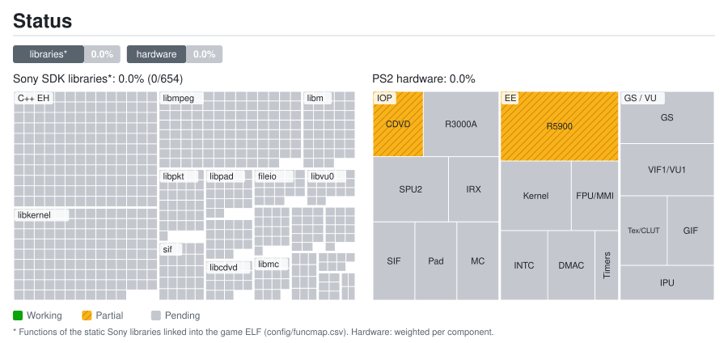
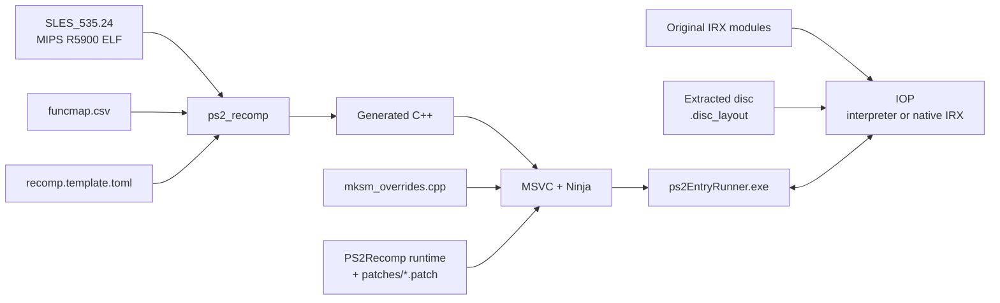

<div align="center">

# Mortal Kombat: Shaolin Monks — PS2 Static Recompilation

**A native Windows port of *Mortal Kombat: Shaolin Monks* (PS2, PAL `SLES-53524`) built by statically recompiling
MIPS R5900 code to C++.**


[](https://github.com/joaodvalexandre/mksm-ps2-recomp/actions/workflows/tests.yml)

</div>

---

> [!IMPORTANT]
> This repository **does not contain any game files** (ISO, executable, IRX modules, `.WAD` data or `.SFD` movies),
> nor the C++ code generated from them. You need **your own legal copy** of Mortal Kombat: Shaolin Monks for the PS2.

> [!WARNING]
> **The game does not boot yet.** The executable recompiles and builds; the first runs stop during startup. Progress
> is logged in [`docs/MKSM.md`](docs/MKSM.md).

## Contents

- [What is this?](#what-is-this)
- [Current status](#current-status)
- [Repository layout](#repository-layout)
- [Requirements](#requirements)
- [Building and running](#building-and-running)
- [How it works](#how-it-works)
- [Documentation](#documentation)
- [Credits and license](#credits-and-license)

## What is this?

Instead of emulating the PlayStation 2, this project **translates the game's original executable (`SLES_535.24`)
into C++** with [PS2Recomp](https://github.com/ran-j/PS2Recomp) and compiles it into a native Windows program.

The runtime is PS2Recomp's with [Waffle565](https://github.com/Waffle565)'s native runtime on top, which replaces
the PS2 hardware with native code:

| Layer | Native replacement | Shaolin Monks |
|---|---|---|
| **EE CPU** (game code) | Static recompilation to C++ | 13,630 functions from the analyzer (the ELF has no symbols) |
| **VU1** (vector microcode) | Microprograms compiled ahead of time to C++, interpreter as fallback | To verify |
| **GS** (graphics) | OpenGL render-target renderer, 2x internal resolution | To verify |
| **IOP** (I/O CPU) | IRX modules in the interpreter, or compiled ahead of time to C++ | 9 IRX modules |
| **Sound** (SPU2) | Native sound engine driven by LIBSD calls | CRI ADX runs over LIBSD; to verify |
| **Pad / memory card** | EE-side handlers, no SIO2 model | Classic libpad/libmc stubbed to those handlers |
| **Movies** (IPU) | MPEG-2 through native libmpeg2 | Sofdec `.SFD` movies; to verify |
| **Disc** | Files extracted from the disc, each at its original sector | Works as is |
| **Video timing** | VBlank at 59.94 Hz | The game is PAL (50 Hz): field rate has to become configurable |

This repository contains only what is specific to the game:

| Component | Description |
|---|---|
| **Function map** | Function boundaries of the ELF (`config/funcmap.csv`) |
| **Recompiler configuration** | Stubs, entry points and instruction patches (`config/recomp.template.toml`) |
| **Game overrides** | Replacements and diagnostics for game functions (`src/mksm_overrides.cpp`) |
| **Runtime patches** | The native runtime and fixes on top, one patch per topic (`patches/`) |
| **Build scripts** | Reproducible pipeline on Windows (`scripts/`) |
| **Tools** | Disc extractor, function map fix-up, native VU1 and IOP generators, CI and status map (`tools/`) |

## Current status

| Milestone | Status |
|---|:---:|
| Disc extracted with its sector layout | ✅ |
| Function map and recompiler configuration for `SLES_535.24` | ✅ |
| `SLES_535.24` recompiled to C++ and native executable (MSVC, x64) | ✅ |
| Boot through the SDK startup (`_InitSys`) | 🔧 in progress |
| First movie and the main menu | ⏳ pending |
| Pad and memory card | ⏳ pending |
| ADX audio and SFD movies | ⏳ pending |
| Gameplay at full speed, PAL 50 Hz timing | ⏳ pending |
| Extras (higher frame rates, widescreen, improvements) | ⏳ later |

<a href="docs/status/details.md"></a>

Per-library and per-component breakdown: [`docs/status/details.md`](docs/status/details.md), generated from
`docs/status/data.toml` by `tools/status/generate.py`.

## Repository layout

```
.
├── .github/workflows/            # CI: tests (tests.yml) and status map (status.yml)
├── AGENTS.md                     # Project conventions for contributors and agents
├── config/
│   ├── funcmap.csv               # Function map (name, start, end, size)
│   └── recomp.template.toml      # PS2Recomp configuration (@ELF@, @MAP@, @OUT@)
├── docs/
│   ├── MKSM.md                   # Research log and next steps
│   ├── ARCHITECTURE.md           # Pipeline, overrides, runtime patches and CI
│   └── status/                   # Status map data and generated SVG/tables
├── game/                         # YOUR disc files go here: SLES_535.24, IOP\, GAMEDATA.WA*, .disc_layout (git-ignored)
├── mksm-work/                    # PS2Recomp clone and build output (git-ignored, created by the build)
├── patches/                      # PS2Recomp patches, applied in scripts/build.ps1 order
├── scripts/
│   ├── 1_install_tools.cmd       # Installs Git and the VS Build Tools with winget
│   ├── 2_build.cmd               # Full pipeline (MKSM_IOP_MODULOS: native IOP)
│   ├── 2_rebuild_fast.cmd        # Rebuilds only src/ (~1 min)
│   ├── 3_run.cmd                 # Runs for 60 s and saves logs
│   ├── 3_run_manual.cmd          # Runs with no time limit
│   └── *.ps1                     # Script logic (common.ps1, build.ps1, run.ps1…)
├── src/
│   ├── mksm_overrides.cpp        # Game-specific overrides
│   └── mksm_gs_replay.h          # Optional bounded GS capture
├── tests/                        # Game-independent tests and known suite failures
└── tools/
    ├── ci/                       # CI helpers (patch order, config, tests)
    ├── status/generate.py        # Status map generator
    ├── funcmap_fixup.py          # Completes the analyzer's map: code gaps and jump targets
    ├── iop/iopn_gen.py           # Compiles the game's IRX to C++ (native IOP)
    ├── vu1/vu1n_gen.py           # Compiles the VU1 microcode to C++ (native VU1)
    └── iso_extract.py            # Extracts the disc keeping its original sectors (--layout)
```

## Requirements

- Windows 10/11 x64
- [Visual Studio](https://visualstudio.microsoft.com/downloads/) 2022 or later (Community or Build Tools) with the
  **C++** workload, which includes CMake and Ninja
- [Git](https://git-scm.com/)
- [Python 3](https://www.python.org/) (disc extraction and the native VU1/IOP generators)
- 16 GB of RAM recommended (the build uses every core) and ~10 GB of disk space for the extracted disc and the build
- Your own copy of **Mortal Kombat: Shaolin Monks (PAL, SLES-53524)**

`scripts\1_install_tools.cmd` installs Git and the Build Tools with `winget`. CMake and Ninja do not need to be on
`PATH`: `2_build.cmd` loads the MSVC environment of the newest Visual Studio installed.

## Building and running

**1. Extract the disc.** The runtime reads the game's data from the extracted disc files, each at its original
sector (the ISO is not read). With Python 3:

```bat
python tools\iso_extract.py "game\SLES_535.24.Mortal Kombat Shaolin Monks.iso" game --layout
```

This leaves `SLES_535.24`, `SYSTEM.CNF`, `IOP\*.IRX`, the `GAMEDATA.WA*` volumes, `FRONT\MOVIES\*.SFD` and the
`.disc_layout` index in `game\`. If the ELF is somewhere else, point `MKSM_ELF` at it; the disc files must sit next
to it. `MKSM_ISO=<path>` makes the runtime read the image directly instead.

**2. Install the tools** (first time only):

```bat
scripts\1_install_tools.cmd
```

**3. Build** (20–40 min):

```bat
scripts\2_build.cmd
```

The script clones PS2Recomp into `mksm-work` inside the repository folder (git-ignored), pins commit `c5a9d02`,
applies the patches in `patches/`, generates the C++ code and builds `ps2EntryRunner.exe`. Progress goes to
`logs\2_build.log`. `MKSM_WORK` moves the work folder; use a short path if you hit the 260-character path limit.
`scripts\2_build.cmd -Traces` enables the function and IOP RPC traces, which are off in release builds.

After changing only `src/`, `scripts\2_rebuild_fast.cmd` rebuilds in about a minute.

**4. Run:**

```bat
scripts\3_run.cmd          :: 60 seconds, output in logs\
scripts\3_run_manual.cmd   :: no time limit
```

The game starts in borderless fullscreen: **F11** switches to a window and back, **F1** opens the runtime debugger
and **F2** shows an FPS meter.

**Native IOP (optional).** The game's IRX modules can be compiled ahead of time instead of running in the IOP
interpreter. One run dumps the modules and the next build uses them:

```bat
set PS2X_IOP_DUMP_MODULES=%CD%\logs\iop_modulos
scripts\3_run.cmd
set PS2X_IOP_DUMP_MODULES=
set MKSM_IOP_MODULOS=%CD%\logs\iop_modulos
scripts\2_build.cmd
```

## How it works



More details in [`docs/ARCHITECTURE.md`](docs/ARCHITECTURE.md).

## Documentation

- [`docs/MKSM.md`](docs/MKSM.md) — research log: disc, executable, what each test showed and next steps
- [`docs/ARCHITECTURE.md`](docs/ARCHITECTURE.md) — pipeline, overrides, runtime patches and CI
- [`AGENTS.md`](AGENTS.md) — project conventions for contributors and coding agents

## Credits and license

- [**PS2Recomp**](https://github.com/ran-j/PS2Recomp) by ran-j and contributors — recompiler and runtime (GPL-3.0).
- [**Waffle565**](https://github.com/Waffle565) — native runtime (GS, VU1, IOP, sound, DMA, disc) and tools that this
  port builds on.
- [**KIexster**](https://github.com/KIexster) — the earlier port whose patch stack, scripts and CI this repository
  started from.
- [**PCSX2**](https://github.com/PCSX2/pcsx2) contributors — EE interpreter and VU operations of the runtime
  (`ee_ref/`, `vu_pcsx2/`) (GPL-3.0+).
- [**Urban Reign recomp**](https://github.com/thiagordsfx/urban-reign-recomp) by thiagordsfx — shared GS integration
  reference.
- [**SotC runtime fork**](https://github.com/LightVelox/PS2Recomp/tree/ac9efa070638ad3b3accd284de6f898d5ab271d1) by
  Taylor N. Albarnaz / LightVelox — OpenGL GS backend and command queue, and EE fixes (GPL-3.0, `ac9efa0`).
- *Mortal Kombat: Shaolin Monks* was developed by Midway Studios Los Angeles and published by Midway. *Mortal Kombat*
  is a trademark of Warner Bros. Entertainment Inc. This project is not affiliated with or endorsed by them. No game
  content is distributed.

The code in this repository is released under the **GPL-3.0** license, consistent with PS2Recomp.
See [`LICENSE`](LICENSE).
